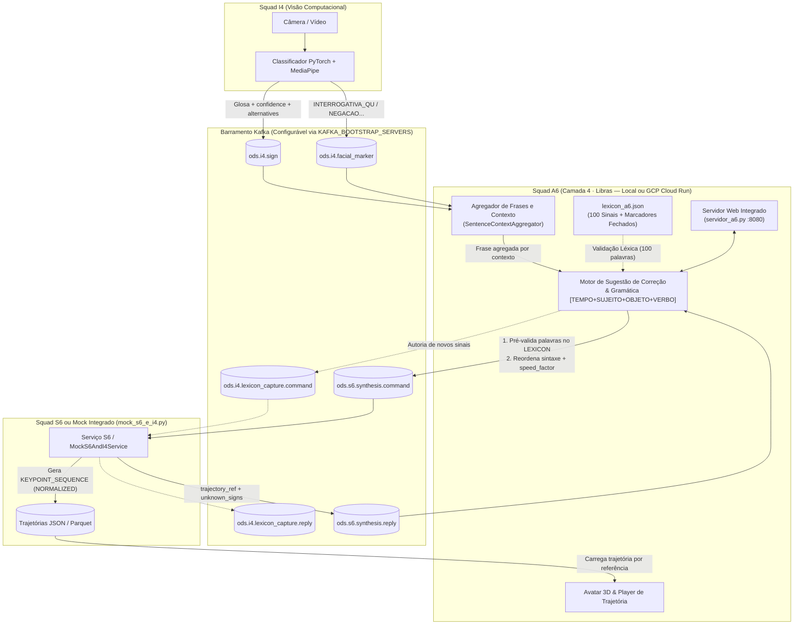

# 🤟 APL-2 · A6 — Tradutor Bidirecional de LIBRAS & Avatar 3D (Camada 4 · Arquitetura 6c)

**Squad A6 · Acessibilidade em LIBRAS**
* **Integrantes:** Daniel Chateaubriand Lago · Lucas Daniel Lana Maciel · Henrique Augusto Miranda Teixeira
* **Papel na Arquitetura ODS (6c):** Camada 4 (Aplicação Pura). Traduz nos dois sentidos (Libras $\leftrightarrow$ Português) com gramática própria, gerencia o artefato oficial **`LEXICON`** (100 sinais + marcadores faciais), opera o motor de **Sugestão de Correção**, agrega sinais em frases por contexto em tempo real, comanda captura (**I4**) e síntese (**S6**) via barramento **Kafka (B2/TRA-1)** e disponibiliza a interface web (localmente ou no **Google Cloud Run**).

---

## 🗺️ 1. Arquitetura e Fluxo do Barramento Kafka



---

## 📂 2. Estrutura de Arquivos e Ambientes do Projeto `a6/`

| Componente | Ambiente | Dependências | Função Principal |
| :--- | :---: | :---: | :--- |
| `servidor_a6.py` | `generic` (Py 3.12) | `requirements-generic.txt` | Servidor Web completo (HTTP + dashboard interativo + cliente Kafka + `<model-viewer>` 3D). |
| `lexicon_a6.json` | Ambos | N/A | **Artefato oficial `lexicon-a6-1.3`**: 100 glosas catalogadas com classes gramaticais e marcadores. |
| `sugestao_correcao_pipeline.py` | `generic` (Py 3.12) | `requirements-generic.txt` | Pré-validação léxica preventiva, motor de sugestão por similaridade e reordenação gramatical. |
| `kafka_integration.py` | `generic` (Py 3.12) | `requirements-generic.txt` | Produtor/Consumidor Kafka e agregador de contexto por pausas temporais (`SentenceContextAggregator`). |
| `mock_s6_e_i4.py` | `generic` (Py 3.12) | `requirements-generic.txt` | Mock dos vizinhos S6 e I4 para testes locais e em nuvem no padrão de trajetória canônica do S6. |
| `simular_i4_para_a6.py` | `generic` (Py 3.12) | `requirements-generic.txt` | Script de simulação de transmissão contínua de sinais de I4 para testar agrupamento de frases. |
| `testar_com_s6.py` | `generic` (Py 3.12) | `requirements-generic.txt` | Envia comando de síntese de A6 para o S6 e aguarda a resposta com `trajectory_ref`. |
| `avatar/generate_video.py` | `blender` (Py 3.11) | `requirements-blender.txt` | Processa trajetórias JSON, interpola poses de repouso e exporta animação `.glb` (`ArmatureAction`). |
| `avatar/avatar_keypoints.py` | `blender` (Py 3.11) | `requirements-blender.txt` | Mapeador cinemático de landmarks para a armadura do modelo 3D usando `bpy`. |
| `avatar/trajectory_format.py` | `blender` (Py 3.11) | `requirements-blender.txt` | Validador e normalizador de coordenadas para o padrão do avatar. |
| `avatar/viewer.py` | `generic` (Py 3.12) | `requirements-generic.txt` | Visualizador 3D interativo de desktop utilizando Panda3D. |
| `Dockerfile` | Nuvem | `python:3.12-slim` | Configuração de empacotamento para deploy no Google Cloud Run. |

---

## ⚙️ 3. Instalação e Ambientes Virtuais (`uv`)

O projeto necessita de **dois ambientes virtuais distintos**:
* **`generic` (Python 3.12):** Para web, Kafka, sugestão de correção e visualização Panda3D.
* **`blender` (Python 3.11):** Obrigatório para o módulo `bpy` (Blender).

### 3.1. Instalar o gerenciador `uv`

* **Windows (PowerShell):**
  ```powershell
  powershell -ExecutionPolicy ByPass -c "irm https://astral.sh/uv/install.ps1 | iex"
  ```
* **Linux / macOS (Bash):**
  ```bash
  curl -LsSf https://astral.sh/uv/install.sh | sh
  source $HOME/.local/bin/env
  ```

### 3.2. Criar os Ambientes Virtuais

Dentro da pasta `a6/`:

* **Windows (PowerShell):**
  ```powershell
  uv venv --python 3.12 envs/generic
  uv pip install --python envs\generic\Scripts\python.exe -r requirements-generic.txt

  uv venv --python 3.11 envs/blender
  uv pip install --python envs\blender\Scripts\python.exe -r requirements-blender.txt
  ```

* **Linux / macOS (Bash):**
  ```bash
  uv venv --python 3.12 envs/generic
  uv pip install --python envs/generic/bin/python -r requirements-generic.txt

  uv venv --python 3.11 envs/blender
  uv pip install --python envs/blender/bin/python -r requirements-blender.txt
  ```

---

## 🚀 4. Comandos de Execução (Windows vs. Linux)

Todos os comandos devem ser executados a partir do diretório **`a6/`**.

### 4.1. Configuração do Endereço do Broker Kafka (Opcional)

Se o professor ou a infraestrutura fornecer um IP institucional:

* **Windows (PowerShell):**
  ```powershell
  $env:KAFKA_BOOTSTRAP_SERVERS = "SEU_IP:PORTA"
  ```
* **Linux / macOS (Bash):**
  ```bash
  export KAFKA_BOOTSTRAP_SERVERS="SEU_IP:PORTA"
  ```

---

### 4.2. Iniciar o Servidor Web da Aplicação A6 (`servidor_a6.py`)

Abre a interface gráfica no navegador em **`http://localhost:8080`**:

* **Windows:**
  ```powershell
  .\envs\generic\Scripts\python.exe servidor_a6.py --port 8080
  ```
* **Linux / macOS:**
  ```bash
  ./envs/generic/bin/python servidor_a6.py --port 8080
  ```

---

### 4.3. Iniciar o Mock dos Vizinhos S6 e I4 (`mock_s6_e_i4.py`)

Escuta e responde às requisições de síntese e captura no barramento:

* **Windows:**
  ```powershell
  .\envs\generic\Scripts\python.exe mock_s6_e_i4.py
  ```
* **Linux / macOS:**
  ```bash
  ./envs/generic/bin/python mock_s6_e_i4.py
  ```

---

### 4.4. Consumidor Kafka e Agregador de Frases em Terminal (`kafka_integration.py`)

Escuta os tópicos de eventos e salva os JSONs em `mensagens_recebidas_kafka/`:

* **Windows:**
  ```powershell
  .\envs\generic\Scripts\python.exe kafka_integration.py
  ```
* **Linux / macOS:**
  ```bash
  ./envs/generic/bin/python kafka_integration.py
  ```

---

### 4.5. Simular Recepção em Tempo Real de I4 (`simular_i4_para_a6.py`)

Dispara mensagens simulando a câmera e testando o agrupamento por pausas:

* **Windows:**
  ```powershell
  .\envs\generic\Scripts\python.exe simular_i4_para_a6.py
  ```
* **Linux / macOS:**
  ```bash
  ./envs/generic/bin/python simular_i4_para_a6.py
  ```

---

### 4.6. Testar Síntese de Frases em Linha de Comando (`testar_com_s6.py`)

* **Windows:**
  ```powershell
  .\envs\generic\Scripts\python.exe testar_com_s6.py --frase "O estudante desejar banco cinco?" --speed 1.0
  ```
* **Linux / macOS:**
  ```bash
  ./envs/generic/bin/python testar_com_s6.py --frase "O estudante desejar banco cinco?" --speed 1.0
  ```

---

### 4.7. Ferramentas do Avatar 3D

#### Gerar `.glb` animado a partir de um JSON de trajetória:
* **Windows:**
  ```powershell
  .\envs\blender\Scripts\python.exe avatar/generate_video.py --arquivo avatar/entry/6d9c234fcd35.json --saida avatar/saida --keep-json
  ```
* **Linux / macOS:**
  ```bash
  ./envs/blender/bin/python avatar/generate_video.py --arquivo avatar/entry/6d9c234fcd35.json --saida avatar/saida --keep-json
  ```

#### Abrir visualizador 3D desktop (Panda3D):
* **Windows:**
  ```powershell
  .\envs\generic\Scripts\python.exe avatar/viewer.py avatar/saida/aluno_corrigido.glb
  ```
* **Linux / macOS:**
  ```bash
  ./envs/generic/bin/python avatar/viewer.py avatar/saida/aluno_corrigido.glb
  ```

---

## ☁️ 5. Deploy no Google Cloud Platform (GCP Cloud Run)

### 5.1. Deploy do Serviço
Dentro da pasta `a6/`:

* **Windows (PowerShell):**
  ```powershell
  gcloud run deploy a6-libras `
    --source . `
    --region us-central1 `
    --allow-unauthenticated `
    --no-cpu-throttling `
    --min-instances 1 `
    --max-instances 1 `
    --set-env-vars KAFKA_BOOTSTRAP_SERVERS="SEU_IP:PORTA"
  ```

* **Linux / macOS (Bash):**
  ```bash
  gcloud run deploy a6-libras \
    --source . \
    --region us-central1 \
    --allow-unauthenticated \
    --no-cpu-throttling \
    --min-instances 1 \
    --max-instances 1 \
    --set-env-vars KAFKA_BOOTSTRAP_SERVERS="SEU_IP:PORTA"
  ```

### 5.2. Pausar Serviço para Economizar Créditos
* **Windows (PowerShell):**
  ```powershell
  gcloud run services update a6-libras --region us-central1 --min-instances 0 --cpu-throttling
  ```
* **Linux / macOS (Bash):**
  ```bash
  gcloud run services update a6-libras --region us-central1 --min-instances 0 --cpu-throttling
  ```

---

## 🧠 6. Regras de Negócio e Expressões Não-Manuais (ENMs)

### 6.1. Agregação Temporal de Frases
* **Pausa $\Delta t < 3.0\text{s}$:** Une os sinais na mesma oração (`[TEMPO] + [SUJEITO] + [OBJETO] + [VERBO]`).
* **Pausa $\Delta t \ge 3.0\text{s}$:** Encerra o contexto aberto e inicia uma nova frase.
* **Silêncio $\ge 3.5\text{s}$:** Fecha automaticamente a frase ativa e gera o arquivo `FRASE_FECHADA_*.json`.

### 6.2. Aspect Ratios Faciais (ENMs)
As expressões não-manuais do conjunto fechado (`INTERROGATIVA_SN`, `INTERROGATIVA_QU`, `NEGACAO`, `AFIRMACAO`, `INTENSIDADE`, `NEUTRO`) são calculadas sobre pontos do MediaPipe Face Mesh:

* **Eye Aspect Ratio (Abertura Ocular):**
  $$\text{EAR} = \frac{\lVert p_{160} - p_{144}\rVert + \lVert p_{158} - p_{153}\rVert}{2 \cdot \lVert p_{33} - p_{133}\rVert}$$
  * $\text{EAR} > 0.28$: Olhos arregalados (`INTERROGATIVA_SN`, `INTENSIDADE`).
  * $\text{EAR} < 0.18$: Olhos semicerrados (`INTERROGATIVA_QU`).

* **Mouth Aspect Ratio (Abertura Labial Vertical):**
  $$\text{MAR} = \frac{\lVert p_{13} - p_{14}\rVert + \lVert p_{82} - p_{87}\rVert + \lVert p_{312} - p_{317}\rVert}{3 \cdot \lVert p_{61} - p_{291}\rVert}$$
  * $\text{MAR} > 0.38$: Expressão enfática oral.
  * $\text{MAR} < 0.18$: Lábios em repouso.

* **Brow Aspect Ratio (Sobrancelhas):**
  $$\text{BAR}_{\text{altura}} = \frac{\lVert p_{70} - p_{159}\rVert + \lVert p_{300} - p_{386}\rVert}{2 \cdot \lVert p_{33} - p_{263}\rVert} \qquad \text{BAR}_{\text{juntas}} = \frac{\lVert p_{70} - p_{300}\rVert}{\lVert p_{33} - p_{263}\rVert}$$
  * $\text{BAR}_{\text{altura}} > 0.32$: Sobrancelhas levantadas (`INTERROGATIVA_SN`).
  * $\text{BAR}_{\text{juntas}} < 0.30$: Sobrancelhas franzidas/unidas (`INTERROGATIVA_QU`).

* **Normalized Mouth Corner Ratio (Comissuras Labiais):**
  $$\text{NMAR} = \frac{\lVert p_{61} - p_{291}\rVert}{\lVert p_{33} - p_{263}\rVert}$$
  * $\text{NMAR} > 0.70$: Lábios esticados horizontalmente (`AFIRMACAO`).
