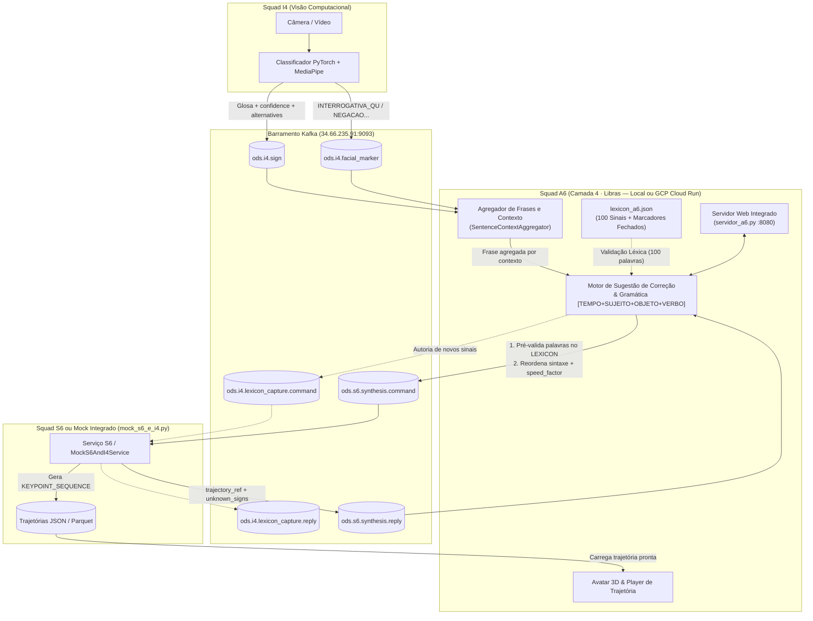

# 🤟 APL-2 · A6 — Tradutor Bidirecional de LIBRAS & Avatar 3D (Camada 4 · Arquitetura 6c)

**Squad A6 · Acessibilidade em LIBRAS**

* **Integrantes:** Daniel Chateaubriand Lago · Lucas Daniel Lana Maciel · Henrique Augusto Miranda Teixeira
* **Papel na Arquitetura ODS (6c):** Camada 4 (Aplicação Pura) — Traduz nos dois sentidos (Libras $\leftrightarrow$ Português) com gramática própria, gerencia o artefato oficial **`LEXICON`** (100 sinais + conjunto fechado de marcadores faciais), opera o motor de **Sugestão de Correção**, agrega sinais em frases por contexto em tempo real, comanda a captura (**I4**) e a síntese (**S6**) via barramento **Kafka (B2/TRA-1)** e disponibiliza a aplicação web (local ou em nuvem no **Google Cloud Run**).

---

## 🗺️ 1. Arquitetura e Conexão entre A6, I4 e S6 (Barramento Kafka)

Na arquitetura **6c**, cada squad tem responsabilidades estritamente separadas:

* **I4 (Visão / Inferência):** Captura a câmera, extrai keypoints e publica os sinais reconhecidos (`ods.i4.sign`) e marcadores faciais (`ods.i4.facial_marker`), além de responder a comandos de gravação de novos sinais (`ods.i4.lexicon_capture.command` $\to$ `.reply`).
* **S6 (Síntese de Trajetória):** Recebe os comandos de glosas de A6 (`ods.s6.synthesis.command`), interpola os sinais do léxico com transições suaves e devolve a referência da trajetória (`ods.s6.synthesis.reply` com `trajectory_ref` e `unknown_signs`).
* **A6 (Aplicação / Gramática / Sugestão / Avatar):** Define o **`LEXICON`**, agrega os sinais em frases por contexto em tempo real, faz a **Sugestão de Correção** (tanto na entrada de baixa confiança de I4 quanto na pré-validação antes de enviar para S6), fornece o **Mock dos Vizinhos (`mock_s6_e_i4.py`)** para testes independentes das 100 palavras e hospeda a interface integrada (`servidor_a6.py`).



---

## 📂 2. Estrutura de Arquivos do Projeto `a6/`

| Arquivo / Pasta | Ambiente | Descrição |
| --- | --- | --- |
| `lexicon_a6.json` | Ambos | **Artefato `LEXICON` oficial de A6 (`lexicon-a6-1.3`)**: contém as **100 glosas** (`signs`), suas categorias gramaticais (`TEMPO`, `SUJEITO`, `OBJETO`, `VERBO`) e o conjunto fechado de marcadores faciais (`markers`). |
| `sugestao_correcao_pipeline.py` | `generic` | **Pipeline de Sugestão de Correção e Gramática (somente palavras/glosas)**: pré-valida palavras contra o `LEXICON` antes de enviar ao S6, avalia sinais de baixa confiança de I4 (`alternatives`), trata `unknown_signs` e reordena frases para `[TEMPO] + [SUJEITO] + [OBJETO] + [VERBO]`. |
| `kafka_integration.py` | `generic` | **Serviço Kafka de A6 + Agregador de Contexto (`SentenceContextAggregator`)**: consome `ods.i4.sign`, `ods.i4.facial_marker` e `ods.s6.synthesis.reply`, detecta início/fim de frases em tempo real e salva tudo em `mensagens_recebidas_kafka/`. |
| `mock_s6_e_i4.py` | `generic` | **Mock Oficial dos Vizinhos (S6 e I4)**: escuta `ods.s6.synthesis.command` (suportando todas as 100 palavras do `lexicon_a6.json`, gerando trajetórias em `trajectories_mock/` e respondendo em `ods.s6.synthesis.reply`) e `ods.i4.lexicon_capture.command` ($\to$ `.reply`). |
| `servidor_a6.py` | `generic` | **Servidor Web da Aplicação A6**: aplicação completa (HTTP + interface web + integração Kafka + Mock de fallback) para rodar localmente ou no **Google Cloud Run**. |
| `Dockerfile` / `.dockerignore` | Nuvem (GCP) | Configuração de container leve (`python:3.12-slim`) para deploy direto do componente `A6` no **Google Cloud Run**. |
| `simular_i4_para_a6.py` | `generic` | Simulador em tempo real que publica sinais seguidos de I4 no Kafka para testar a agregação de frases no mesmo contexto vs. mudança de contexto por pausa ($\ge 3.0\text{s}$). |
| `testar_com_s6.py` | `generic` | Envia um comando `ods.s6.synthesis.command` de A6 para o S6 via Kafka e aguarda a resposta `ods.s6.synthesis.reply`. |
| `avatar/avatar_keypoints.py` | `blender` | Renderiza os quadros de keypoints no rig 3D (`ybot.fbx`) usando Blender (`bpy`), gerando imagens `.png` e animação `.glb`. |
| `avatar/generate_video.py` | `blender` | Concatena múltiplos sinais com transições suaves e gera um vídeo `.mp4` do avatar. |
| `avatar/viewer.py` | `generic` | Visualizador 3D interativo (Panda3D) para abrir e inspecionar animações `.glb` do avatar em janela gráfica. |
| `rotulador.py` / `rotulador_mao.py` | `generic` | Ferramentas de captura e rotulação de expressões faciais (Aspect Ratios) e configurações de mão via webcam. |

---

## ⚙️ 3. Configuração dos Ambientes Virtuais (`uv`)

O projeto utiliza **dois ambientes virtuais separados** gerenciados pelo [uv](https://docs.astral.sh/uv/), pois a biblioteca `bpy` (Blender como módulo Python) exige obrigatoriamente o **Python 3.11**, enquanto os módulos do Kafka, Servidor Web, Panda3D e MediaPipe rodam no ambiente `generic` (**Python 3.12+**).

| Ambiente | Pasta sugerida | Versão Python | Arquivo de Dependências | Para que serve? |
| --- | --- | --- | --- | --- |
| **Geral (`generic`)** | `envs/generic` | `3.12` (ou `3.14`) | `requirements-generic.txt` | Servidor Web (`servidor_a6.py`), Kafka, Mock S6/I4, Sugestão de Correção, Viewer 3D (`viewer.py`), Rotuladores. |
| **Blender (`blender`)** | `envs/blender` | `3.11` (obrigatório) | `requirements-blender.txt` | Renderização do Avatar 3D (`avatar_keypoints.py`, `generate_video.py`, `fbx_to_glb.py`). |

### Passo 1: Instalar o `uv`

* **Windows (PowerShell):**
```powershell
powershell -ExecutionPolicy ByPass -c "irm https://astral.sh/uv/install.ps1 | iex"
```

* **Linux / macOS:**
```bash
curl -LsSf https://astral.sh/uv/install.sh | sh
source $HOME/.local/bin/env
```

Confira a instalação com:
```bash
uv --version
```

### Passo 2: Criar os Dois Ambientes Virtuais e Instalar Dependências

Entre na pasta `a6`:
```powershell
cd a6
```

#### No Windows (PowerShell):
```powershell
# 1. Criar e instalar o ambiente GENERIC (Servidor Web, Kafka, Mock, Sugestão de Correção, Viewer 3D):
uv venv --python 3.12 envs/generic
uv pip install --python envs\generic\Scripts\python.exe -r requirements-generic.txt

# 2. Criar e instalar o ambiente BLENDER (Python 3.11 obrigatório para o bpy):
uv venv --python 3.11 envs/blender
uv pip install --python envs\blender\Scripts\python.exe -r requirements-blender.txt
```

#### No Linux / macOS:
```bash
# 1. Criar e instalar o ambiente GENERIC:
uv venv --python 3.12 envs/generic
uv pip install --python envs/generic/bin/python -r requirements-generic.txt

# 2. Criar e instalar o ambiente BLENDER (Python 3.11):
uv venv --python 3.11 envs/blender
uv pip install --python envs/blender/bin/python -r requirements-blender.txt
```

### Passo 3: Como Ativar os Ambientes (ou Rodar Direto)

* **Ativar no Windows (PowerShell):**
```powershell
# Ativar ambiente generic (lembre-se do .\ no início):
.\envs\generic\Scripts\Activate.ps1

# Para sair do ambiente:
deactivate
```

* **Ativar no Linux / macOS:**
```bash
source envs/generic/bin/activate
```

* **Ou rodar direto sem precisar ativar:** basta chamar o executável do ambiente desejado (`.\envs\generic\Scripts\python.exe <script.py>` ou `.\envs\blender\Scripts\python.exe <script.py>`).

---

## 🚀 4. Guia de Comandos Principais (Com Exemplos Práticos)

Todos os comandos abaixo são executados diretamente a partir da pasta **`a6/`**.

---

### 4.1. Rodar o Servidor Web Completo da Aplicação A6 (`servidor_a6.py`)

Inicia a aplicação completa do componente `A6` (interface web interativa + consumidor/produtor Kafka + agregador de contexto em tempo real + Mock integrado de S6/I4):

```powershell
# Com o ambiente generic ativado:
python servidor_a6.py --port 8080

# Ou sem ativar o ambiente:
.\envs\generic\Scripts\python.exe servidor_a6.py --port 8080
```

* Acesse no navegador: **`http://localhost:8080`**
* Para rodar **sem** o Mock interno (usando exclusivamente respostas externas no Kafka):
```powershell
.\envs\generic\Scripts\python.exe servidor_a6.py --port 8080 --no-mock
```

---

### 4.2. Rodar o Mock dos Componentes Vizinhos S6 e I4 (`mock_s6_e_i4.py`)

Como o `S6` real possui apenas 20 sinais gravados em `.parquet` (enquanto o `LEXICON` de `A6` possui **100 sinais**) e o comando `ods.i4.lexicon_capture.command` ainda não foi implementado pelo grupo `I4`, você pode subir o Mock no barramento Kafka para responder aos comandos de `A6`:

```powershell
# Escuta ods.s6.synthesis.command e ods.i4.lexicon_capture.command no Kafka e publica as replies:
.\envs\generic\Scripts\python.exe mock_s6_e_i4.py
```

---

### 4.3. Iniciar Apenas o Consumidor Kafka e Agregador de Frases via Terminal (`kafka_integration.py`)

Conecta ao broker Kafka (`34.66.235.91:9093`), escuta os sinais de **I4** (`ods.i4.sign`, `ods.i4.facial_marker`) e as respostas de **S6** (`ods.s6.synthesis.reply`), agrega os sinais em frases por contexto e salva todos os JSONs recebidos na pasta `a6/mensagens_recebidas_kafka/`.

```powershell
.\envs\generic\Scripts\python.exe kafka_integration.py
```

* **Configurações opcionais por variável de ambiente:**
```powershell
# Trocar o endereço do broker Kafka:
$env:KAFKA_BOOTSTRAP_SERVERS="34.66.235.91:9093"

# Ler mensagens desde o início do tópico ("earliest") ou apenas novas ("latest"):
$env:KAFKA_AUTO_OFFSET_RESET="latest"
.\envs\generic\Scripts\python.exe kafka_integration.py
```

---

### 4.4. Testar a Funcionalidade de Recebimento do I4 em Tempo Real (`simular_i4_para_a6.py`)

Envia uma sequência de sinais via Kafka simulando o **I4** em tempo real para testar:

1. Sinais com intervalo curto ($< 3.0\text{s}$) sendo unidos na **mesma frase (`frase-001`)**.
2. Sinais com baixa confiança (`confidence < 0.75`) acionando a **Sugestão de Correção** via `alternatives`.
3. Uma pausa longa ($\ge 3.0\text{s}$) fechando a `frase-001` e abrindo automaticamente um **novo contexto (`frase-002`)**.

```powershell
# Terminal 1 (deixe rodando o servidor web ou o kafka_integration.py):
.\envs\generic\Scripts\python.exe kafka_integration.py

# Terminal 2 (dispare a simulação em tempo real):
.\envs\generic\Scripts\python.exe simular_i4_para_a6.py
```

> 📁 **Onde ver o resultado:** Abra a pasta `a6/mensagens_recebidas_kafka/` para ver os arquivos individuais de cada mensagem e os arquivos consolidados `FRASE_FECHADA_frase-001.json` e `FRASE_FECHADA_frase-002.json`.

---

### 4.5. Testar a Funcionalidade com o S6 via CLI (`testar_com_s6.py`)

Testa o fluxo onde o usuário digita uma frase em Português, o **A6** faz a **pré-validação e sugestão de correção ANTES de enviar** (trocando palavras fora do léxico pelas equivalentes das 100 palavras do `LEXICON`), reordena na gramática da Libras (`[TEMPO] + [SUJEITO] + [OBJETO] + [VERBO]`), publica `ods.s6.synthesis.command` no barramento Kafka e aguarda a resposta `ods.s6.synthesis.reply` do **S6** com o `trajectory_ref`.

```powershell
# Na pasta a6, envie uma frase para o S6 no barramento Kafka com controle de velocidade:
.\envs\generic\Scripts\python.exe testar_com_s6.py --frase "O estudante desejar banco cinco?" --speed 1.0
```

* No exemplo acima, o A6 detecta antes de enviar que `"estudante"` e `"desejar"` não estão no léxico, sugere/aplica **`"ALUNO"`** e **`"VONTADE"`**, reordena para `["ALUNO", "BANCO", "CINCO", "VONTADE"]`, anexa o marcador facial `INTERROGATIVA_SN` e publica para o S6 (ou `mock_s6_e_i4.py`) consumir no Kafka!

---

### 4.6. Comandos do Avatar 3D (Renderização Blender e Visualizador Panda3D)

> ⚠️ **Atenção:** Os scripts que geram animações/vídeos (`avatar_keypoints.py`, `generate_video.py`, `fbx_to_glb.py`) usam `bpy` e **devem rodar com o Python do ambiente `envs/blender` (Python 3.11)**. Já o visualizador interativo (`viewer.py`) usa Panda3D e **deve rodar no ambiente `envs/generic`**.

#### A. Renderizar Keypoints no Avatar 3D e Exportar Animação `.glb`
```powershell
.\envs\blender\Scripts\python.exe avatar/avatar_keypoints.py avatar/saida/exemplo_aluno_avatar.json --model avatar/ybot.fbx --render-dir avatar/saida --export-glb avatar/saida/aluno_corrigido.glb
```

#### B. Visualizar o Avatar `.glb` Animado em Janela 3D Interativa
```powershell
.\envs\generic\Scripts\python.exe avatar/viewer.py avatar/saida/aluno_corrigido.glb
```

* **Controles na janela do `viewer.py`:**
  * **Arrastar botão esquerdo:** Girar câmera | **Arrastar botão direito:** Mover câmera (pan)
  * **Roda do mouse:** Zoom | **Teclas `1`..`9`:** Tocar animação
  * **Espaço:** Pausar / Continuar | **R:** Resetar câmera | **ESC:** Sair

#### C. Gerar um Vídeo `.mp4` Completo com Vários Sinais e Transições
```powershell
.\envs\blender\Scripts\python.exe avatar/generate_video.py avatar/geral --model avatar/ybot.fbx -o avatar/saida/frase.mp4
```

#### D. Converter um Modelo `.fbx` do Mixamo para `.glb`
```powershell
.\envs\blender\Scripts\python.exe avatar/fbx_to_glb.py avatar/ybot.fbx avatar/ybot.glb
```

---

## ☁️ 5. Deploy em Nuvem no Google Cloud Platform (GCP Cloud Run)

O componente `A6` já possui `Dockerfile` e `.dockerignore` prontos para rodar 100% em nuvem no **Google Cloud Run**, conectando-se diretamente ao broker Kafka na nuvem (`34.66.235.91:9093`) e gerando uma URL HTTPS pública.

### Passo 1: Autenticar e Selecionar o Projeto no `gcloud`
```powershell
# 1. Fazer login na conta GCP que possui os créditos (Billing Account ativa):
gcloud auth login

# 2. Listar seus projetos ou criar um projeto novo:
gcloud projects list
# (Opcional) Criar projeto novo e vinculá-lo à sua conta de faturamento:
# gcloud projects create ods-a6-libras-ufsj --set-as-default
# gcloud billing accounts list
# gcloud billing projects link ods-a6-libras-ufsj --billing-account=<SEU_BILLING_ACCOUNT_ID>

# 3. Definir o projeto como ativo:
gcloud config set project ods-a6-libras-ufsj
```

### Passo 2: Habilitar as APIs e Permissões de Build (Apenas na 1ª vez no projeto)
```powershell
# 1. Habilitar Cloud Run, Cloud Build e Artifact Registry:
gcloud services enable run.googleapis.com cloudbuild.googleapis.com artifactregistry.googleapis.com

# 2. Caso o projeto seja recém-criado, garantir permissões de Build/Log para a Service Account Compute:
# (Substitua <PROJECT_NUMBER> pelo número do projeto exibido em `gcloud projects list`)
gcloud projects add-iam-policy-binding ods-a6-libras-ufsj `
  --member="serviceAccount:<PROJECT_NUMBER>-compute@developer.gserviceaccount.com" `
  --role="roles/cloudbuild.builds.builder"

gcloud projects add-iam-policy-binding ods-a6-libras-ufsj `
  --member="serviceAccount:<PROJECT_NUMBER>-compute@developer.gserviceaccount.com" `
  --role="roles/storage.objectAdmin"

gcloud projects add-iam-policy-binding ods-a6-libras-ufsj `
  --member="serviceAccount:<PROJECT_NUMBER>-compute@developer.gserviceaccount.com" `
  --role="roles/artifactregistry.writer"

gcloud projects add-iam-policy-binding ods-a6-libras-ufsj `
  --member="serviceAccount:<PROJECT_NUMBER>-compute@developer.gserviceaccount.com" `
  --role="roles/logging.logWriter"
```

### Passo 3: Fazer o Deploy do Componente `A6` para o Cloud Run
Dentro da pasta `a6/`, execute:
```powershell
gcloud run deploy a6-libras `
  --source . `
  --region us-central1 `
  --allow-unauthenticated `
  --no-cpu-throttling `
  --min-instances 1 `
  --max-instances 1 `
  --set-env-vars KAFKA_BOOTSTRAP_SERVERS=34.66.235.91:9093
```
Ao final do comando, o terminal exibirá o **`Service URL`** (ex: `https://a6-libras-xxxxxxxxxx-uc.a.run.app`), que pode ser aberto em qualquer navegador!

### Passo 4: Economizar Créditos após os Testes 💰
Para zerar o consumo de créditos quando não estiver testando em tempo real com o Kafka:
```powershell
gcloud run services update a6-libras --region us-central1 --min-instances 0 --cpu-throttling
```

---

## 🧠 6. Como Funciona a Inteligência de A6 (Resumo Técnico)

### 6.1. Sugestão de Correção Somente com Palavras (`sugestao_correcao_pipeline.py`)

1. **Sentido Libras $\to$ Português (`ods.i4.sign`):**
   * Quando `confidence < 0.75` ou a glosa não pertence ao `LEXICON`, o sistema não trava nem falha em silêncio: ele coleta as opções do campo `alternatives` enviadas por I4 e complementa com busca por similaridade no `LEXICON` de 100 sinais.
2. **Sentido Português $\to$ Libras (`ods.s6.synthesis.command` / `.reply`):**
   * **Pré-validação Preventiva (Antes de enviar ao S6):** Compara cada palavra da frase com as 100 glosas de `lexicon_a6.json`. Se uma palavra não existir no léxico (ex: `"estudante"`, `"desejar"`, `"colégio"`), sugere e substitui automaticamente pela glosa oficial (`"ALUNO"`, `"VONTADE"`, `"ESCOLA"`) usando mapeamento semântico de sinônimos, radical morfológico e distância de edição (`difflib`).
   * **Fallback Reativo (`unknown_signs`):** Caso o S6 ainda devolva algum sinal em `unknown_signs` na `ods.s6.synthesis.reply`, o A6 gera sugestões do `LEXICON` para cada item desconhecido.

### 6.2. Agregação de Frases e Detecção de Contexto em Tempo Real (`SentenceContextAggregator`)

Como o I4 envia um evento `ods.i4.sign` por sinal isolado, o A6 identifica se os sinais pertencem à **mesma frase** ou a um **novo contexto** através de 4 regras:

1. **Pausa Temporal ($\Delta t \ge 3.0\text{s}$):** Calcula `start_at(sinal_atual) - end_at(sinal_anterior)`. Se for menor que $3\text{s}$, agrega na mesma frase; se for $\ge 3\text{s}$, fecha a frase anterior e abre novo contexto.
2. **Timeout de Silêncio em Tempo Real ($3.5\text{s}$):** Se o usuário parar de sinalizar por $3.5\text{s}$, o loop fecha automaticamente a frase aberta e salva o arquivo `FRASE_FECHADA_frase-XXX.json`.
3. **Quebra Gramatical (`[TEMPO]` após oração completa):** Se a frase atual já possui `[TEMPO]` e `[VERBO]` e chega um novo marcador de `[TEMPO]`, inicia nova oração.
4. **Troca de Sinalizador (`signer_id`):** Separa contextos diferentes por pessoa.

---

## 📐 7. Mapeamento Geométrico das Expressões Não-Manuais (ENMs) em LIBRAS

Na Língua Brasileira de Sinais (LIBRAS), as **Expressões Não-Manuais (ENMs)** desempenham um papel gramatical fundamental para definir a intenção (perguntas, afirmações, negações) e a intensidade dos sinais. No conjunto fechado do artefato `LEXICON` de A6, elas são mapeadas nos marcadores:

* `INTERROGATIVA_SN` (Perguntas Sim/Não)
* `INTERROGATIVA_QU` (Perguntas Quem, Onde, Como, Por quê)
* `NEGACAO`
* `AFIRMACAO`
* `INTENSIDADE`
* `NEUTRO`

Para capturar essas variações na ferramenta de rotulação (`rotulador.py` e `testes/calculos_ar.py`) de forma robusta e independente da distância da câmera, utilizam-se **Aspect Ratios (Razões de Aspecto)** sobre os *landmarks* do **MediaPipe Face Mesh**:

### 1. Eye Aspect Ratio (EAR) — *Abertura dos Olhos*

$$\text{EAR} = \frac{\lVert p_{160} - p_{144}\rVert + \lVert p_{158} - p_{153}\rVert}{2 \cdot \lVert p_{33} - p_{133}\rVert}$$

* **EAR Elevado ($> 0.28$):** Olhos arregalados — acompanham perguntas gerais (`INTERROGATIVA_SN`), surpresa e `INTENSIDADE`.
* **EAR Baixo ($< 0.18$):** Olhos semi-cerrados — acompanham dúvida ou perguntas específicas (`INTERROGATIVA_QU`).

### 2. Mouth Aspect Ratio (MAR) — *Abertura Vertical da Boca*

$$\text{MAR} = \frac{\lVert p_{13} - p_{14}\rVert + \lVert p_{82} - p_{87}\rVert + \lVert p_{312} - p_{317}\rVert}{3 \cdot \lVert p_{61} - p_{291}\rVert}$$

* **MAR Elevado ($> 0.38$):** Boca aberta — fonemas faciais visuais e ênfase.
* **MAR Baixo ($< 0.18$):** Lábios cerrados ou em repouso.

### 3. Brow Aspect Ratio (BAR) — *Movimentação das Sobrancelhas*

$$\text{BAR}_{\text{altura}} = \frac{\frac{\lVert p_{70} - p_{159}\rVert + \lVert p_{300} - p_{386}\rVert}{2}}{\lVert p_{33} - p_{263}\rVert} \qquad \text{BAR}_{\text{juntas}} = \frac{\lVert p_{70} - p_{300}\rVert}{\lVert p_{33} - p_{263}\rVert}$$

* **$\text{BAR}_{\text{altura}}$ Elevada ($> 0.32$):** Sobrancelhas levantadas — marca gramatical de **`INTERROGATIVA_SN`**.
* **$\text{BAR}_{\text{juntas}}$ Baixa ($< 0.30$):** Sobrancelhas franzidas/juntas — marca gramatical de **`INTERROGATIVA_QU`**.

### 4. Normalized Mouth Corner Ratio (NMAR) — *Esticamento Lateral da Boca*

$$\text{NMAR} = \frac{\lVert p_{61} - p_{291}\rVert}{\lVert p_{33} - p_{263}\rVert}$$

* **NMAR Elevado ($> 0.70$) com MAR Baixo:** Confirmação ou **`AFIRMACAO`**.

### 5. Pucker Ratio (PUP) — *Bico / Lábios Projetados*

$$\text{PUP} = \frac{\lVert p_{0} - p_{17}\rVert}{\lVert p_{61} - p_{291}\rVert}$$

* **PUP Elevado ($> 0.45$):** Lábios projetados para indicar coisas pequenas/precisas.

### 6. Cheek Aspect Ratio (CAR) — *Bochechas Infladas*

$$\text{CAR} = \frac{\lVert p_{234} - p_{454}\rVert}{\lVert p_{1} - p_{152}\rVert}$$

* **CAR Elevado ($> 1.65$):** Bochechas infladas — marca gramatical de **`INTENSIDADE`** (grande volume, peso ou quantidade).

### 7. Nasal Aspect Ratio (NAR) — *Nariz Franzido*

$$\text{NAR} = \frac{\lVert p_{198} - p_{2}\rVert}{\lVert p_{133} - p_{362}\rVert}$$

* **NAR Baixo ($< 0.38$):** Nariz franzido — acompanha expressões de **`NEGACAO`** ou aversão.
