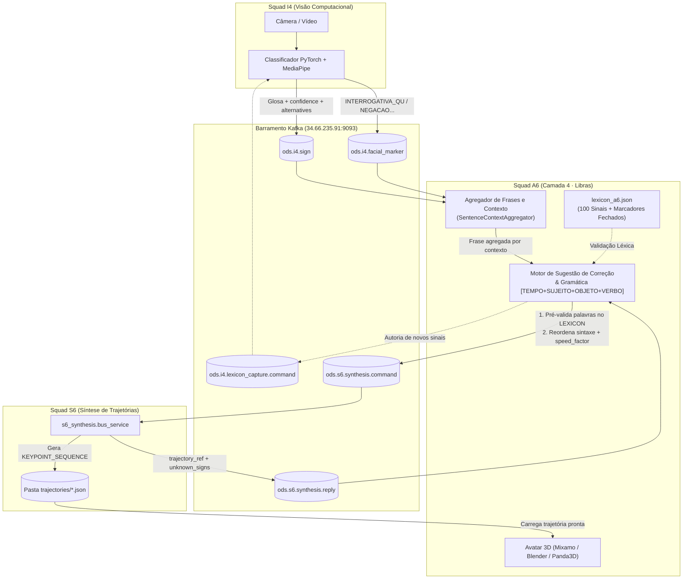

# 🤟 APL-2 · A6 — Tradutor Bidirecional de LIBRAS & Avatar 3D (Camada 4 · Arquitetura 6c)

**Squad A6 · Acessibilidade em LIBRAS**
* **Integrantes:** Daniel Chateaubriand Lago · Lucas Daniel Lana Maciel · Henrique Augusto Miranda Teixeira
* **Papel na Arquitetura ODS (6c):** Camada 4 (Aplicação Pura) — Traduz nos dois sentidos (Libras $\leftrightarrow$ Português) com gramática própria, gerencia o artefato oficial **`LEXICON`** (100 sinais + conjunto fechado de marcadores faciais), opera o motor de **Sugestão de Correção**, comanda a captura (**I4**) e a síntese (**S6**) via barramento **Kafka (B2/TRA-1)** e apresenta o **Avatar 3D**.

---

## 🗺️ 1. Arquitetura e Conexão entre A6, I4 e S6 (Barramento Kafka)

Na arquitetura **6c**, cada squad tem responsabilidades estritamente separadas:
* **I4 (Visão / Inferência):** Captura a câmera, extrai keypoints e publica os sinais reconhecidos (`ods.i4.sign`) e marcadores faciais (`ods.i4.facial_marker`).
* **S6 (Síntese de Trajetória):** Recebe os comandos de glosas de A6 (`ods.s6.synthesis.command`), interpola os sinais do léxico com transições suaves e devolve a referência da trajetória (`ods.s6.synthesis.reply` com `trajectory_ref`).
* **A6 (Aplicação / Gramática / Sugestão / Avatar):** Define o **`LEXICON`**, agrega os sinais em frases por contexto em tempo real, faz a **Sugestão de Correção** (tanto na entrada de baixa confiança de I4 quanto na pré-validação antes de enviar para S6) e renderiza a trajetória no **Avatar 3D**.



---

## 📂 2. Estrutura de Arquivos do Projeto `a6/`

| Arquivo / Pasta | Ambiente | Descrição |
| :--- | :--- | :--- |
| [`lexicon_a6.json`](file:///c:/Users/lucas/OneDrive/Documentos/Estudos/Programas/Oitavo%20Periodo/ODS/a6/lexicon_a6.json) | Ambos | **Artefato `LEXICON` oficial de A6**: contém as **100 glosas** (`signs`), suas categorias gramaticais (`TEMPO`, `SUJEITO`, `OBJETO`, `VERBO`) e o conjunto fechado de marcadores faciais (`markers`). |
| [`sugestao_correcao_pipeline.py`](file:///c:/Users/lucas/OneDrive/Documentos/Estudos/Programas/Oitavo%20Periodo/ODS/a6/sugestao_correcao_pipeline.py) | `generic` | **Pipeline de Sugestão de Correção e Gramática**: pré-valida palavras contra o `LEXICON` antes de enviar ao S6, avalia sinais de baixa confiança de I4 (`alternatives`), trata `unknown_signs` e reordena frases para `[TEMPO] + [SUJEITO] + [OBJETO] + [VERBO]`. |
| [`kafka_integration.py`](file:///c:/Users/lucas/OneDrive/Documentos/Estudos/Programas/Oitavo%20Periodo/ODS/a6/kafka_integration.py) | `generic` | **Serviço Kafka de A6 + Agregador de Contexto (`SentenceContextAggregator`)**: consome `ods.i4.sign`, `ods.i4.facial_marker` e `ods.s6.synthesis.reply`, detecta início/fim de frases em tempo real e salva tudo em `mensagens_recebidas_kafka/`. |
| [`simular_i4_para_a6.py`](file:///c:/Users/lucas/OneDrive/Documentos/Estudos/Programas/Oitavo%20Periodo/ODS/a6/simular_i4_para_a6.py) | `generic` | Simulador realista que publica sinais seguidos de I4 no Kafka para testar a agregação de frases no mesmo contexto vs. mudança de contexto por pausa. |
| [`testar_com_s6.py`](file:///c:/Users/lucas/OneDrive/Documentos/Estudos/Programas/Oitavo%20Periodo/ODS/a6/testar_com_s6.py) | `generic` | Envia um comando `ods.s6.synthesis.command` real de A6 para o S6 via Kafka e aguarda a resposta `ods.s6.synthesis.reply`. |
| [`avatar/avatar_keypoints.py`](file:///c:/Users/lucas/OneDrive/Documentos/Estudos/Programas/Oitavo%20Periodo/ODS/a6/avatar/avatar_keypoints.py) | `blender` | Renderiza os quadros de keypoints no rig 3D (`ybot.fbx`) usando Blender (`bpy`), gerando imagens `.png` e animação `.glb`. |
| [`avatar/generate_video.py`](file:///c:/Users/lucas/OneDrive/Documentos/Estudos/Programas/Oitavo%20Periodo/ODS/a6/avatar/generate_video.py) | `blender` | Concatena múltiplos sinais com transições suaves e gera um vídeo `.mp4` do avatar. |
| [`avatar/viewer.py`](file:///c:/Users/lucas/OneDrive/Documentos/Estudos/Programas/Oitavo%20Periodo/ODS/a6/avatar/viewer.py) | `generic` | Visualizador 3D interativo (Panda3D) para abrir e inspecionar animações `.glb` do avatar em janela gráfica. |
| [`rotulador.py`](file:///c:/Users/lucas/OneDrive/Documentos/Estudos/Programas/Oitavo%20Periodo/ODS/a6/rotulador.py) / [`rotulador_mao.py`](file:///c:/Users/lucas/OneDrive/Documentos/Estudos/Programas/Oitavo%20Periodo/ODS/a6/rotulador_mao.py) | `generic` | Ferramentas de captura e rotulação de expressões faciais (Aspect Ratios) e configurações de mão via webcam. |

---

## ⚙️ 3. Configuração dos Ambientes Virtuais (`uv`)

O projeto utiliza **dois ambientes virtuais separados** gerenciados pelo [uv](https://docs.astral.sh/uv/), pois a biblioteca `bpy` (Blender como módulo Python) exige obrigatoriamente o **Python 3.11**, enquanto os módulos do Kafka, Panda3D e MediaPipe rodam no ambiente `generic` (**Python 3.12+**).

| Ambiente | Pasta sugerida | Versão Python | Arquivo de Dependências | Para que serve? |
| :--- | :--- | :--- | :--- | :--- |
| **Geral (`generic`)** | `envs/generic` | `3.12` (ou `3.14`) | `requirements-generic.txt` | Kafka, Sugestão de Correção, Visualizador 3D (`viewer.py`), Rotuladores. |
| **Blender (`blender`)** | `envs/blender` | `3.11` (obrigatório) | `requirements-blender.txt` | Renderização do Avatar 3D (`avatar_keypoints.py`, `generate_video.py`, `fbx_to_glb.py`). |

### Passo 1: Instalar o `uv`

* **Windows (PowerShell):**
  ```powershell
  powershell -ExecutionPolicy ByPass -c "irm https://astral.sh/uv/install.ps1 | iex"
  ```
* **Linux / macOS:**
  ```bash
  curl -LsSf https://astral.sh/uv/install.sh | sh
  source $HOME/.local/bin/env
  ```
Confira a instalação com:
```bash
uv --version
```

### Passo 2: Criar os Dois Ambientes Virtuais e Instalar Dependências

Entre na pasta `a6`:
```powershell
cd a6
```

#### No Windows (PowerShell):
```powershell
# 1. Criar e instalar o ambiente GENERIC (Kafka, Sugestão de Correção, Viewer 3D):
uv venv --python 3.12 envs/generic
uv pip install --python envs\generic\Scripts\python.exe -r requirements-generic.txt

# 2. Criar e instalar o ambiente BLENDER (Python 3.11 obrigatório para o bpy):
uv venv --python 3.11 envs/blender
uv pip install --python envs\blender\Scripts\python.exe -r requirements-blender.txt
```

#### No Linux / macOS:
```bash
# 1. Criar e instalar o ambiente GENERIC:
uv venv --python 3.12 envs/generic
uv pip install --python envs/generic/bin/python -r requirements-generic.txt

# 2. Criar e instalar o ambiente BLENDER (Python 3.11):
uv venv --python 3.11 envs/blender
uv pip install --python envs/blender/bin/python -r requirements-blender.txt
```

### Passo 3: Como Ativar os Ambientes (ou Rodar Direto)

* **Ativar no Windows (PowerShell):**
  ```powershell
  # Ativar ambiente generic (lembre-se do .\ no início):
  .\envs\generic\Scripts\Activate.ps1

  # Para sair do ambiente:
  deactivate
  ```
* **Ativar no Linux / macOS:**
  ```bash
  source envs/generic/bin/activate
  ```
* **Ou rodar direto sem precisar ativar:** basta chamar o executável do ambiente desejado (`.\envs\generic\Scripts\python.exe <script.py>` ou `.\envs\blender\Scripts\python.exe <script.py>`).

---

## 🚀 4. Guia de Comandos Principais (Com Exemplos Práticos)

Todos os comandos abaixo devem ser executados a partir da pasta **`a6/`**.

---

### 4.1. Iniciar o Consumidor Kafka e Agregador de Frases de A6

Conecta ao broker Kafka (`34.66.235.91:9093`), escuta os sinais de **I4** (`ods.i4.sign`, `ods.i4.facial_marker`) e as respostas de **S6** (`ods.s6.synthesis.reply`), agrega os sinais em frases por contexto e salva todos os JSONs recebidos na pasta `a6/mensagens_recebidas_kafka/`.

```powershell
# Com o ambiente generic ativado:
python kafka_integration.py

# Ou sem ativar o ambiente:
.\envs\generic\Scripts\python.exe kafka_integration.py
```

* **Configurações opcionais por variável de ambiente:**
  ```powershell
  # Trocar o endereço do broker Kafka (ex: quando rodar localmente):
  $env:KAFKA_BOOTSTRAP_SERVERS="localhost:9092"

  # Ler mensagens desde o início do tópico ("earliest") ou apenas novas ("latest"):
  $env:KAFKA_AUTO_OFFSET_RESET="latest"
  python kafka_integration.py
  ```

---

### 4.2. Simular o Envio de Sinais em Tempo Real do I4 para o A6 (Teste de Contexto)

Envia uma sequência de sinais simulando uma pessoa sinalizando ao vivo na câmera para testar:
1. Sinais com intervalo curto ($< 3.0\text{s}$) sendo unidos na **mesma frase (`frase-001`)**.
2. Sinais com baixa confiança acionando a **Sugestão de Correção** via `alternatives`.
3. Uma pausa longa ($\ge 3.0\text{s}$) fechando a `frase-001` e abrindo automaticamente um **novo contexto (`frase-002`)**.

```powershell
# Terminal 1 (deixe rodando):
python kafka_integration.py

# Terminal 2 (dispare a simulação):
python simular_i4_para_a6.py
```
> 📁 **Onde ver o resultado:** Abra a pasta `a6/mensagens_recebidas_kafka/` para ver os arquivos individuais de cada mensagem e os arquivos consolidados `FRASE_FECHADA_frase-001.json` e `FRASE_FECHADA_frase-002.json`.

---

### 4.3. Testar Integração Real com a Equipe I4

Enquanto o seu `python kafka_integration.py` estiver rodando no **Terminal 1**, peça para a equipe **I4** (ou rode você mesmo na pasta `../i4`) publicar um sinal real a partir dos arquivos `.parquet` deles:

```powershell
cd ..\i4

# Exemplo 1: Publicar sinal "Aluno" com confiança alta (0.90):
..\a6\envs\generic\Scripts\python.exe -m pipeline.publica_amostra --parquet lexicon/lexicon-Aluno.parquet --confidence 0.90

# Exemplo 2: Publicar sinal "Ruim" com confiança baixa (0.55) para acionar a Sugestão de Correção em A6:
..\a6\envs\generic\Scripts\python.exe -m pipeline.publica_amostra --parquet lexicon/lexicon-Ruim.parquet --confidence 0.55
```

---

### 4.4. Testar Integração Real com a Equipe S6 (Tradução Português $\to$ Libras)

Testa o fluxo onde o usuário digita uma frase em Português, o **A6** faz a **pré-validação e sugestão de correção ANTES de enviar** (trocando palavras fora do léxico pelas equivalentes das 100 palavras do `LEXICON`), reordena na gramática da Libras (`[TEMPO] + [SUJEITO] + [OBJETO] + [VERBO]`), publica `ods.s6.synthesis.command` e recebe a resposta `ods.s6.synthesis.reply` do **S6** com o `trajectory_ref`.

```powershell
# Terminal 1 (Na pasta ../i4, suba o serviço de síntese do S6):
cd ..\i4
..\a6\envs\generic\Scripts\python.exe -m s6_synthesis.bus_service --lexicon-dir lexicon --trajectory-dir trajectories --lexicon-version lexicon-a6-1.3

# Terminal 2 (Na pasta a6, envie uma frase para o S6 com controle de velocidade):
cd ..\a6
python testar_com_s6.py --frase "O estudante desejar banco cinco?" --speed 1.0
```
* No exemplo acima, o A6 detecta antes de enviar que `"estudante"` e `"desejar"` não estão no léxico, sugere/aplica **`"ALUNO"`** e **`"VONTADE"`**, reordena para `["ALUNO", "BANCO", "CINCO", "VONTADE"]`, anexa o marcador facial `INTERROGATIVA_SN` e envia ao S6!

---

### 4.5. Comandos do Avatar 3D (Renderização Blender e Visualizador Panda3D)

> ⚠️ **Atenção:** Os scripts que geram animações/vídeos (`avatar_keypoints.py`, `generate_video.py`, `fbx_to_glb.py`) usam `bpy` e **devem rodar com o Python do ambiente `envs/blender` (Python 3.11)**. Já o visualizador interativo (`viewer.py`) usa Panda3D e **deve rodar no ambiente `envs/generic`**.

#### A. Renderizar Keypoints no Avatar 3D e Exportar Animação `.glb`
```powershell
# Usando o ambiente envs/blender (Python 3.11):
.\envs\blender\Scripts\python.exe avatar/avatar_keypoints.py saida_correcoes/exemplo_aluno_avatar.json --model avatar/ybot.fbx --render-dir avatar/saida --export-glb avatar/saida/aluno_corrigido.glb
```

#### B. Visualizar o Avatar `.glb` Animado em Janela 3D Interativa
```powershell
# Usando o ambiente envs/generic:
.\envs\generic\Scripts\python.exe avatar/viewer.py avatar/saida/aluno_corrigido.glb
```
* **Controles na janela do `viewer.py`:**
  * **Arrastar botão esquerdo:** Girar câmera
  * **Arrastar botão direito:** Mover câmera (pan)
  * **Roda do mouse:** Zoom
  * **Teclas `1`..`9`:** Tocar animação
  * **Espaço:** Pausar / Continuar
  * **R:** Resetar câmera | **ESC:** Sair

#### C. Gerar um Vídeo `.mp4` Completo com Vários Sinais e Transições
```powershell
# Usando o ambiente envs/blender (Python 3.11):
.\envs\blender\Scripts\python.exe avatar/generate_video.py avatar/geral --model avatar/ybot.fbx -o avatar/saida/frase.mp4
```

#### D. Converter um Modelo `.fbx` do Mixamo para `.glb`
```powershell
.\envs\blender\Scripts\python.exe avatar/fbx_to_glb.py avatar/ybot.fbx avatar/ybot.glb
```

---

## 🧠 5. Como Funciona a Inteligência de A6 (Resumo Técnico)

### 5.1. Sugestão de Correção Somente com Palavras (`sugestao_correcao_pipeline.py`)
1. **Sentido Libras $\to$ Português (`ods.i4.sign`):**
   * Quando `confidence < 0.75` ou a glosa não pertence ao `LEXICON`, o sistema não trava nem falha em silêncio: ele coleta as opções do campo `alternatives` enviadas por I4 e complementa com busca por similaridade no `LEXICON` de 100 sinais.
2. **Sentido Português $\to$ Libras (`ods.s6.synthesis.command` / `.reply`):**
   * **Pré-validação Preventiva (Antes de enviar ao S6):** Compara cada palavra da frase com as 100 glosas de [`lexicon_a6.json`](file:///c:/Users/lucas/OneDrive/Documentos/Estudos/Programas/Oitavo%20Periodo/ODS/a6/lexicon_a6.json). Se uma palavra não existir no léxico (ex: `"estudante"`, `"desejar"`, `"colégio"`), sugere e substitui automaticamente pela glosa oficial (`"ALUNO"`, `"VONTADE"`, `"ESCOLA"`) usando mapeamento semântico de sinônimos, radical morfológico e distância de edição (`difflib`).
   * **Fallback Reativo (`unknown_signs`):** Caso o S6 ainda devolva algum sinal em `unknown_signs` na `ods.s6.synthesis.reply`, o A6 gera sugestões do `LEXICON` para cada item desconhecido.

### 5.2. Agregação de Frases e Detecção de Contexto em Tempo Real (`SentenceContextAggregator`)
Como o I4 envia um evento `ods.i4.sign` por sinal isolado, o A6 identifica se os sinais pertencem à **mesma frase** ou a um **novo contexto** através de 4 regras:
1. **Pausa Temporal ($\Delta t \ge 3.0\text{s}$):** Calcula `start_at(sinal_atual) - end_at(sinal_anterior)`. Se for menor que $3\text{s}$, agrega na mesma frase; se for $\ge 3\text{s}$, fecha a frase anterior e abre novo contexto.
2. **Timeout de Silêncio em Tempo Real ($3.5\text{s}$):** Se o usuário parar de sinalizar por $3.5\text{s}$, o loop fecha automaticamente a frase aberta e salva o arquivo `FRASE_FECHADA_frase-XXX.json`.
3. **Quebra Gramatical (`[TEMPO]` após oração completa):** Se a frase atual já possui `[TEMPO]` e `[VERBO]` e chega um novo marcador de `[TEMPO]`, inicia nova oração.
4. **Troca de Sinalizador (`signer_id`):** Separa contextos diferentes por pessoa.

---

## 📐 6. Mapeamento Geométrico das Expressões Não-Manuais (ENMs) em LIBRAS

Na Língua Brasileira de Sinais (LIBRAS), as **Expressões Não-Manuais (ENMs)** desempenham um papel gramatical fundamental para definir a intenção (perguntas, afirmações, negações) e a intensidade dos sinais. No conjunto fechado do artefato `LEXICON` de A6, elas são mapeadas nos marcadores:
* `INTERROGATIVA_SN` (Perguntas Sim/Não)
* `INTERROGATIVA_QU` (Perguntas Quem, Onde, Como, Por quê)
* `NEGACAO`
* `AFIRMACAO`
* `INTENSIDADE`
* `NEUTRO`

Para capturar essas variações na ferramenta de rotulação ([`rotulador.py`](file:///c:/Users/lucas/OneDrive/Documentos/Estudos/Programas/Oitavo%20Periodo/ODS/a6/rotulador.py) e [`testes/calculos_ar.py`](file:///c:/Users/lucas/OneDrive/Documentos/Estudos/Programas/Oitavo%20Periodo/ODS/a6/testes/calculos_ar.py)) de forma robusta e independente da distância da câmera, utilizam-se **Aspect Ratios (Razões de Aspecto)** sobre os *landmarks* do **MediaPipe Face Mesh**:

### 1. Eye Aspect Ratio (EAR) — *Abertura dos Olhos*
$$
\text{EAR} = \frac{\lVert p_{160} - p_{144}\rVert + \lVert p_{158} - p_{153}\rVert}{2 \cdot \lVert p_{33} - p_{133}\rVert}
$$
* **EAR Elevado ($> 0.28$):** Olhos arregalados — acompanham perguntas gerais (`INTERROGATIVA_SN`), surpresa e `INTENSIDADE`.
* **EAR Baixo ($< 0.18$):** Olhos semi-cerrados — acompanham dúvida ou perguntas específicas (`INTERROGATIVA_QU`).

### 2. Mouth Aspect Ratio (MAR) — *Abertura Vertical da Boca*
$$
\text{MAR} = \frac{\lVert p_{13} - p_{14}\rVert + \lVert p_{82} - p_{87}\rVert + \lVert p_{312} - p_{317}\rVert}{3 \cdot \lVert p_{61} - p_{291}\rVert}
$$
* **MAR Elevado ($> 0.38$):** Boca aberta — fonemas faciais visuais e ênfase.
* **MAR Baixo ($< 0.18$):** Lábios cerrados ou em repouso.

### 3. Brow Aspect Ratio (BAR) — *Movimentação das Sobrancelhas*
$$
\text{BAR}_{\text{altura}} = \frac{\frac{\lVert p_{70} - p_{159}\rVert + \lVert p_{300} - p_{386}\rVert}{2}}{\lVert p_{33} - p_{263}\rVert} \qquad \text{BAR}_{\text{juntas}} = \frac{\lVert p_{70} - p_{300}\rVert}{\lVert p_{33} - p_{263}\rVert}
$$
* **$\text{BAR}_{\text{altura}}$ Elevada ($> 0.32$):** Sobrancelhas levantadas — marca gramatical de **`INTERROGATIVA_SN`**.
* **$\text{BAR}_{\text{juntas}}$ Baixa ($< 0.30$):** Sobrancelhas franzidas/juntas — marca gramatical de **`INTERROGATIVA_QU`**.

### 4. Normalized Mouth Corner Ratio (NMAR) — *Esticamento Lateral da Boca*
$$
\text{NMAR} = \frac{\lVert p_{61} - p_{291}\rVert}{\lVert p_{33} - p_{263}\rVert}
$$
* **NMAR Elevado ($> 0.70$) com MAR Baixo:** Confirmação ou **`AFIRMACAO`**.

### 5. Pucker Ratio (PUP) — *Bico / Lábios Projetados*
$$
\text{PUP} = \frac{\lVert p_{0} - p_{17}\rVert}{\lVert p_{61} - p_{291}\rVert}
$$
* **PUP Elevado ($> 0.45$):** Lábios projetados para indicar coisas pequenas/precisas.

### 6. Cheek Aspect Ratio (CAR) — *Bochechas Infladas*
$$
\text{CAR} = \frac{\lVert p_{234} - p_{454}\rVert}{\lVert p_{1} - p_{152}\rVert}
$$
* **CAR Elevado ($> 1.65$):** Bochechas infladas — marca gramatical de **`INTENSIDADE`** (grande volume, peso ou quantidade).

### 7. Nasal Aspect Ratio (NAR) — *Nariz Franzido*
$$
\text{NAR} = \frac{\lVert p_{198} - p_{2}\rVert}{\lVert p_{133} - p_{362}\rVert}
$$
* **NAR Baixo ($< 0.38$):** Nariz franzido — acompanha expressões de **`NEGACAO`** ou aversão.
